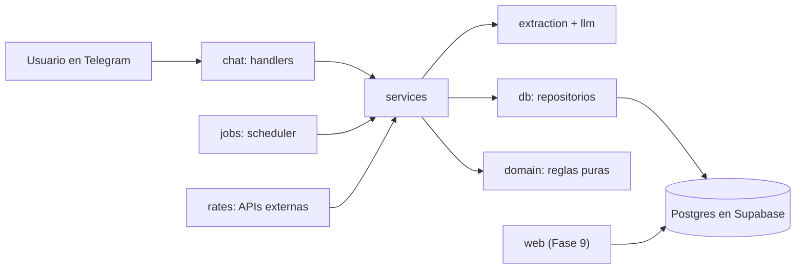

# Gastos multimoneda

Bot de Telegram que registra gastos e ingresos escritos en lenguaje natural ("gasté 15 en el almuerzo") en su moneda original: bolívares, pesos colombianos, dólares o USDT.
Guarda cada movimiento con la tasa del momento, responde preguntas sobre tus finanzas y envía un resumen semanal.
Una app web (en desarrollo) muestra todo centralizado.

> Estado: **Fase 0**, esqueleto del proyecto y CI. Ver [`docs/STACK_Y_ARQUITECTURA.md`](docs/STACK_Y_ARQUITECTURA.md).

## Arquitectura



Cada capa solo importa de las que están por debajo; `import-linter` lo verifica en el CI.

## Desarrollo

Requisitos: Git, Docker, [uv](https://docs.astral.sh/uv/), [Supabase CLI](https://supabase.com/docs/guides/cli) y `make`. En Windows, usa WSL2.

```bash
cp bot/.env.example bot/.env   # rellena los valores
make setup                     # instala dependencias del bot
make hooks                     # instala pre-commit (ruff + gitleaks)
make db-up                     # levanta Supabase local (requiere Docker)
make check                     # lint, tipos, capas, pruebas y pgTAP
```

## Estructura

| Carpeta | Contenido |
|---|---|
| `bot/` | Bot en Python (aiogram, FastAPI, psycopg) |
| `supabase/` | Migraciones, seed y pruebas pgTAP; fuente de verdad del esquema |
| `docs/` | Guía de arquitectura y decisiones (ADR) |
| `web/` | App web en Next.js (Fase 9) |

## Licencia

MIT
