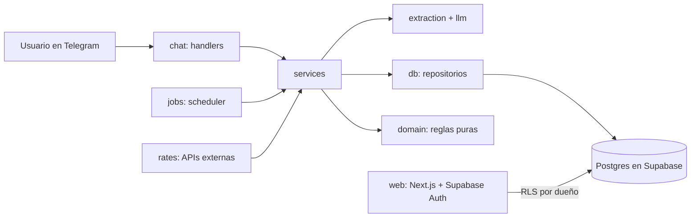

# Asistente de gastos multimoneda

Bot de Telegram que registra gastos e ingresos escritos en lenguaje natural ("gasté 15 en el almuerzo") en su moneda original: bolívares, pesos colombianos, dólares o USDT.
Guarda cada movimiento con la tasa del momento, responde preguntas sobre tus finanzas y envía un resumen semanal.
Una app web (en desarrollo, [`web/`](web/)) muestra todo centralizado: hoy permite crear una cuenta, vincularla con Telegram usando `/vincular` y ver los saldos.

> Estado: **Fase 9**. El bot registra gastos, ingresos y cambios entre monedas escritos como hablas, con la tasa del momento (Bs con BCV, paralelo o P2P; COP y USDT). Responde preguntas sobre tus finanzas con datos reales y cada domingo en la tarde te manda un resumen de la semana con la pérdida (o ganancia) de poder adquisitivo de tus bolívares; también lo puedes pedir con `/resumen`. Si se equivoca, lo corriges escribiendo («eso fue transporte», «eran 20 mil pesos») y lo tiene en cuenta en los mensajes siguientes. En producción corre en Railway con webhook ([`docs/DESPLIEGUE.md`](docs/DESPLIEGUE.md)). La web ([`web/`](web/)) ya tiene registro con correo y contraseña, vinculación con `/vincular` y lectura por dueño con RLS ([ADR 0012](docs/decisions/0012-acceso-web-y-vinculacion.md)). Ver [`docs/STACK_Y_ARQUITECTURA.md`](docs/STACK_Y_ARQUITECTURA.md) y las decisiones en [`docs/decisions/`](docs/decisions/).

## Arquitectura



Cada capa solo importa de las que están por debajo; `import-linter` lo verifica en el CI.

## Desarrollo

Requisitos: Git, Docker Desktop, [uv](https://docs.astral.sh/uv/) y [Supabase CLI](https://supabase.com/docs/guides/cli). Las tareas comunes están en `tasks.ps1` (PowerShell, Windows).

```powershell
Copy-Item bot\.env.example bot\.env   # rellena los valores
.\tasks.ps1 setup                     # instala dependencias del bot
.\tasks.ps1 hooks                     # instala pre-commit (ruff + gitleaks)
.\tasks.ps1 db-up                     # levanta Supabase local (requiere Docker)
.\tasks.ps1 check                     # lint, tipos, capas, pruebas y pgTAP
.\tasks.ps1 run                       # arranca el bot en modo polling
.\tasks.ps1 web-setup                 # instala dependencias de la web (Node 24)
.\tasks.ps1 web                       # web en http://localhost:3000 (ver web/README.md)
.\tasks.ps1 web-check                 # lint, formato, tipos y build de la web
.\tasks.ps1 e2e                       # Playwright: registro, vinculación y saldos
```

Para medir la extracción con el LLM real, `.\tasks.ps1 eval` corre las frases de [`bot/eval/dataset.jsonl`](bot/eval/dataset.jsonl) y guarda el resultado en [`bot/eval/results/`](bot/eval/results/). Consume cuota de Gemini, por eso no corre en el CI.

Supabase local usa los puertos 553xx (base de datos en `127.0.0.1:55322`) para convivir con otros proyectos que usen los puertos por defecto.

## Despliegue

En local el bot usa polling; en producción, si existe `WEBHOOK_URL`, recibe los mensajes por webhook (FastAPI, con secreto y `/health`) y limita los mensajes por minuto de cada persona. La imagen sale de [`bot/Dockerfile`](bot/Dockerfile) (`.\tasks.ps1 image`) y el CI la construye en cada PR. El paso a paso para Supabase en la nube y Railway está en [`docs/DESPLIEGUE.md`](docs/DESPLIEGUE.md).

## Estructura

| Carpeta | Contenido |
|---|---|
| `bot/` | Bot en Python (aiogram, FastAPI, psycopg) |
| `supabase/` | Migraciones, seed y pruebas pgTAP; fuente de verdad del esquema |
| `docs/` | Guía de arquitectura y decisiones (ADR) |
| `web/` | App web en Next.js 16 con Supabase Auth ([`web/README.md`](web/README.md)) |

## Licencia

MIT
